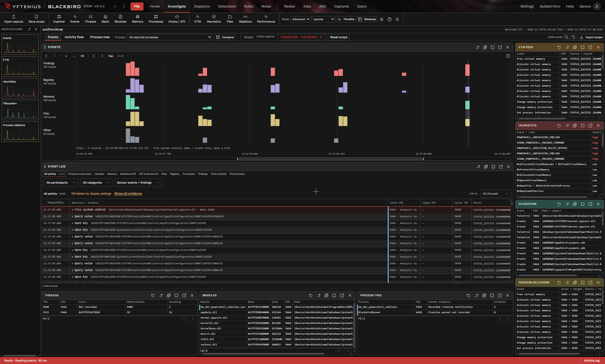
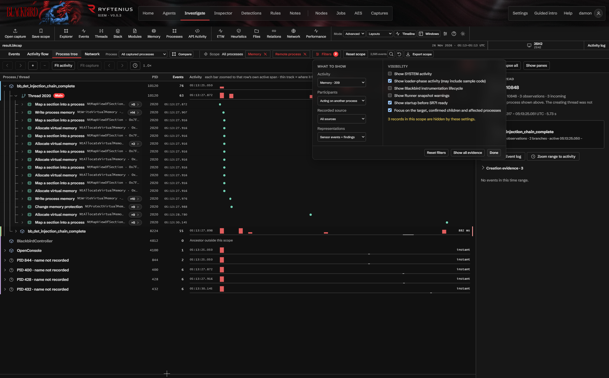
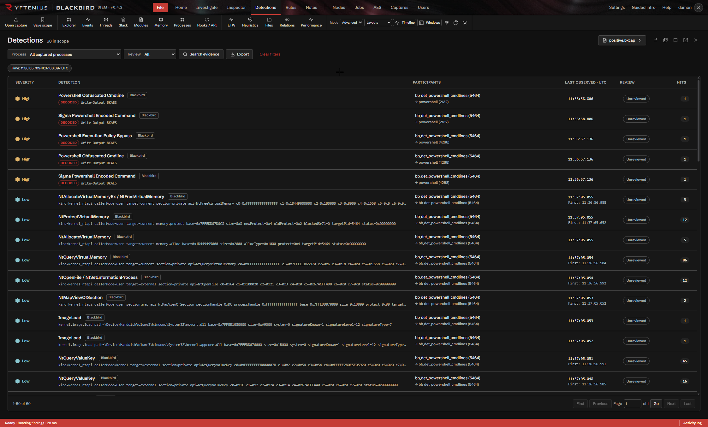
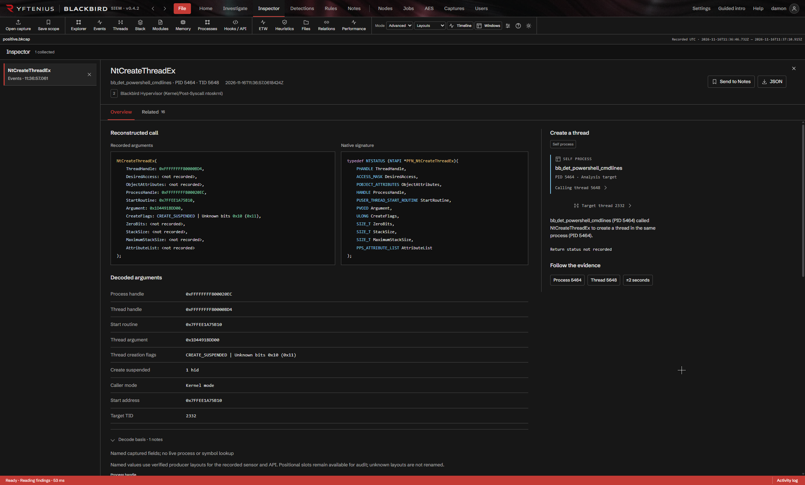
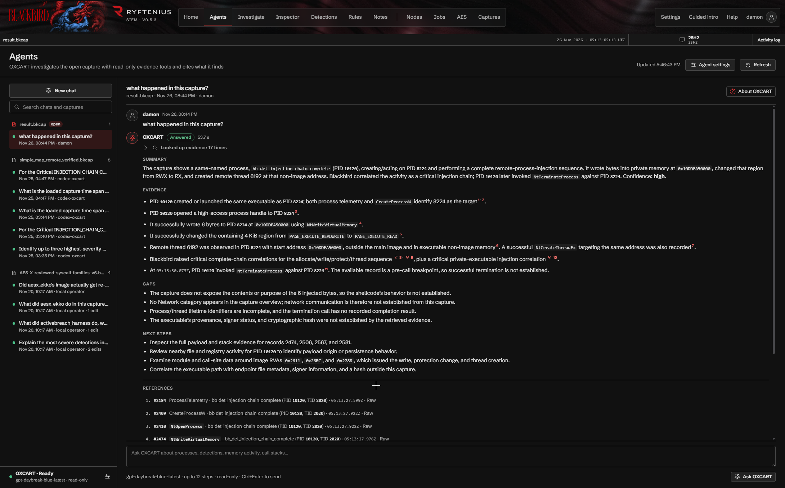
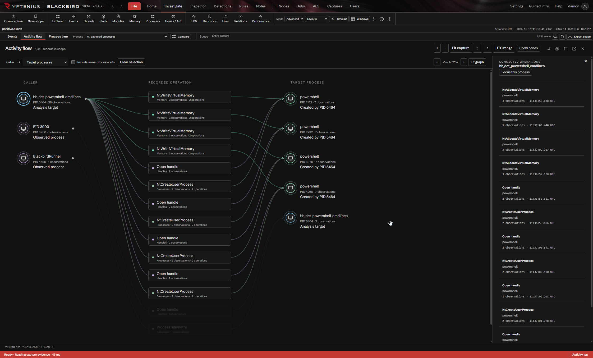
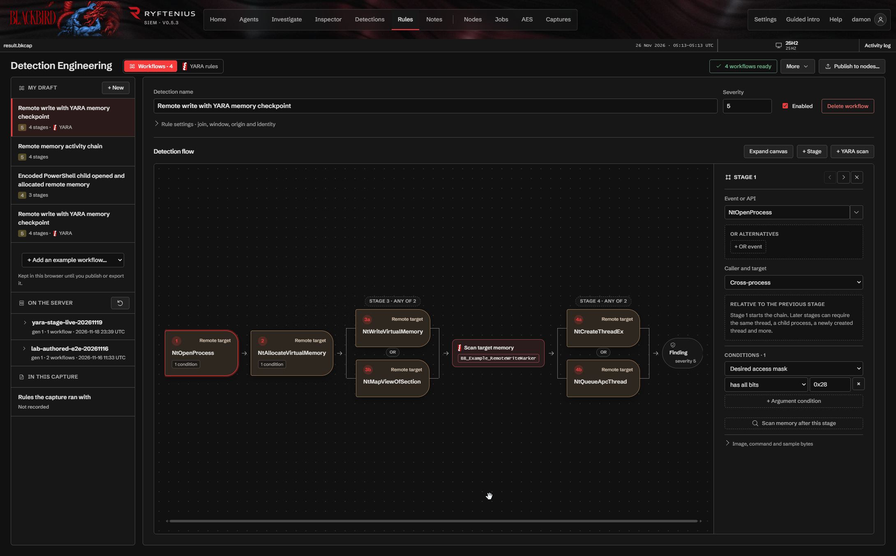
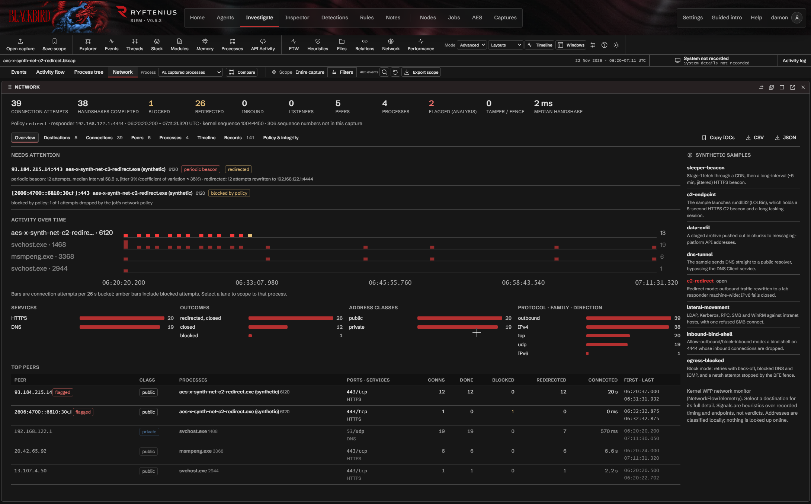

# Blackbird

**Hypervisor-backed malware analysis & intelligence**

 

<a href="#the-future-of-blackbird">Development</a> ·
<a href="#blackbird-in-action">Research</a> ·
<a href="#community-playground">Community</a> ·
<a href="#alpha-previews">Previews</a> ·
<a href="#the-live-analysis-platform">Live Analysis</a> ·
<a href="#current-development-progress">Progress</a> ·
<a href="#public-security-assessment">Security Assessment</a>

---

> [!IMPORTANT]
> Blackbird is currently undergoing extensive development.
> There is no scheduled release date, although I'm tentatively
> aiming for Q1–Q2 2027.

## The future of Blackbird

This community repository will be redesigned into an offline
analysis platform and SIEM for Blackbird capture files (`.bkcap`).

There are currently no plans to open-source future releases
of the live analysis platform.

## Blackbird in action

I've just published my first technical post showcasing Blackbird
in action.

<table>
<tr>
<td>

**[Usermode Injection is Dead](https://ryftenius.com/insight/usermode_injection_dead/)**

Ryftenius · Technical Research

More technical posts will be published over the coming weeks,
so stay tuned!

</td>
</tr>
</table>

## Community playground

I'm also planning to release a publicly accessible, interactive
version of the SIEM, where you'll be able to navigate the UI,
explore capture data and familiarise yourself with Blackbird
using controlled test samples.

---

## Alpha previews

A first look at what I've been working on.

 

<a href="#investigation-workspace">Investigation</a> ·
<a href="#extended-process-tree">Process Tree</a> ·
<a href="#detection--heuristic-analysis">Detections</a> ·
<a href="#native-api-inspector">Inspector</a> ·
<a href="#oxcart">OXCART</a> ·
<a href="#cross-process-activity-flow">Activity Flow</a> ·
<a href="#detection-engineering">Rules</a> ·
<a href="#network-intelligence">Network</a>

> [!NOTE]
> All telemetry and analysis data shown in the following
> screenshots is genuine data produced by Blackbird's
> instrumentation and analysis infrastructure, with the
> exception of the network intelligence preview, which
> uses synthetic data while the interface is in development.
>
> These screenshots represent alpha builds of Blackbird.
> Interfaces and functionality are subject to change.

### Investigation Workspace

BLACKBIRD SIEM · INVESTIGATE · v0.4.2

The main analyst interface. A configurable, multi-pane
workspace exposing the event timeline, event log, threads,
loaded modules, process tree, ETW feed, heuristic findings,
filesystem activity and process relations.

The workspace allows analysts to correlate different sources
of telemetry within the same temporal scope of a capture.

---

### Extended Process Tree

BLACKBIRD SIEM · INVESTIGATE · v0.5.3

An extended process tree exposing individual processes,
their respective threads and the operations they conducted
throughout execution, alongside a visual representation
of their temporal activity.

The screenshot also shows Blackbird's filtering interface,
where analysts can scope observations by activity category,
process participation, recording source and event visibility.

---

### Detection & Heuristic Analysis

BLACKBIRD SIEM · DETECTIONS · v0.4.2

A centralised interface for reviewing behavioural detections,
heuristic findings and rule matches generated throughout
a capture.

Each finding exposes its severity, participating processes,
decoded evidence, observation timestamps and hit counts,
with the ability to investigate the underlying recorded
activity.

---

### Native API Inspector

BLACKBIRD SIEM · INSPECTOR · v0.4.2

The Inspector reconstructs recorded Native API calls
alongside their native function signatures, decoded
arguments, caller context and target attribution.

Analysts can pivot directly into related processes, threads
and surrounding temporal evidence. Arguments that were not
recorded are explicitly marked as such.

The example above shows the reconstruction of a captured
`NtCreateThreadEx` call.

---

### OXCART

BLACKBIRD SIEM · AGENTS · v0.5.3

**OXCART** is Blackbird's integrated agentic analysis system.

OXCART investigates captures through read-only evidence
tools, allowing analysts to ask questions about recorded
behaviour, detections, processes, memory activity and
execution chains.

Responses include citations to individual evidence records,
gaps in the available telemetry and suggested avenues
for further investigation.

The example above shows OXCART independently investigating
a capture containing a remote-process injection chain.

---

### Cross-Process Activity Flow

BLACKBIRD SIEM · INVESTIGATE · v0.4.2

A graph-based visualisation of interactions between captured
processes, exposing caller-to-target relationships through
their recorded operations.

Analysts can inspect individual relationships and their
underlying observations, providing an alternative to
navigating large chronological event logs when investigating
cross-process behaviour.

---

### Detection Engineering

BLACKBIRD SIEM · RULES · v0.5.3

Blackbird's visual detection engineering interface allows
analysts to construct configurable, multi-stage behavioural
detection workflows.

Workflows can incorporate Native API operations,
argument-level conditions, process and thread relationships,
alternative event sequences and YARA memory-scanning
checkpoints.

---

### Network Intelligence

BLACKBIRD SIEM · NETWORK · v0.5.3

The network intelligence interface is being developed to
expose kernel WFP-backed network telemetry, connection
attempts, handshake completion, destination attribution,
connection periodicity, traffic redirection and network
policy enforcement.

> [!NOTE]
> The network interface is still under development.
> Unlike the preceding screenshots, the data shown here
> is synthetic and is being used to develop and validate
> the analytical interface.

---

## The live analysis platform

The closed-source version of Blackbird, which is approximately
nine months ahead of the currently public version, will be
released as a product for malware analysts, security analysts
and reverse engineers to analyse a binary's full, system-wide
behaviour using hypervisor-backed infrastructure.

The goal of Blackbird is to provide a modular, configurable
malware analysis platform capable of dynamically adapting
its analysis environment, detecting malicious behaviour
and presenting a controlled view of the operating system
to the sample under analysis.

Blackbird is explicitly designed to target advanced persistent
threat (APT) malware and aggressive malicious samples that
may go undetected by, or intentionally evade, conventional
malware analysers and EDR/XDR products.

I also want Blackbird to provide as comprehensive a view
of a process's execution as possible, from low-level Native
API activity through to network activity observed below
the user-mode boundary.

### What sets Blackbird apart from an EDR or AV?

**Targeting.**

EDR and AV products must constantly balance system performance
with detection value. They operate within consumer or
enterprise environments that require high performance and
relatively low detection noise.

Since Blackbird is intended to operate within controlled
analysis labs, it has a different set of constraints.

Blackbird is designed around targeted analysis, allowing its
instrumentation to focus on the malicious sample, its child
processes and other relevant processes throughout the system.

This allows us to prioritise the depth and fidelity of
captured telemetry within a dedicated analysis environment.

## Current development progress

Now that's a lot of talk, so how much of this is actually
implemented?

From what my team can confidently say at this stage,
approximately **80%** of the intended functionality has
been implemented.

### Hypervisor & instrumentation

The hypervisor has been rigorously tested across multiple
Intel-based systems running under KVM/QEMU.

According to our current preliminary benchmarks, the
hypervisor introduces an approximate system performance
overhead of **3–15%**, depending on system load.

| Metric | Current status |
| :--- | :--- |
| Estimated implementation progress | ~80% |
| Preliminary hypervisor overhead | ~3–15% |
| Tested CPU architecture | Intel |
| Tested virtualisation environment | KVM/QEMU |
| Development stage | Alpha / extended testing |
| Release target | Q1–Q2 2027 (tentative) |

These are preliminary internal development figures.
Performance varies depending on the workload and system
configuration. They should not be interpreted as final
production benchmarks.

### Detection validation

The [Adversary Emulation Suite](./Adversary%20Emulation%20Suite/)
in this repository is the public-facing subset we use to tune
and test Blackbird detections. Its bounded sample programs
exercise sensor coverage and rule behaviour, while the benign
application corpus helps measure false-positive noise. Build
instructions and use limits are in the [suite README](./Adversary%20Emulation%20Suite/README.md).

Within the scenarios tested so far, the suite passes the
required detections without unwanted detection noise or overflow.

Blackbird is now entering its extended testing phase,
where it will be evaluated against real-world malware,
normal applications and eventually integrated into the
workflows of malware analysts and SOC teams.

The best way I'd put it is that the underlying infrastructure
is concrete. Much of the remaining work revolves around
tuning, packaging, security, UX and performance improvements.

## Public security assessment

We're also planning to organise a public event where select
security researchers and vulnerability researchers will
receive an up-to-date version of Blackbird and conduct
an authorised security assessment.

The event will be hosted live on
[Ryftenius](https://ryftenius.com/), with the results
published publicly and credit given to participating
researchers.

<table>
<thead>
<tr>
<th>Phase</th>
<th>Assessment</th>
<th>Scope</th>
</tr>
</thead>
<tbody>
<tr>
<td><b>01</b></td>
<td>Platform Security</td>
<td>Assessment of local privilege escalation (LPE),
remote code execution (RCE) and denial-of-service (DoS)
vulnerabilities within Blackbird.</td>
</tr>
<tr>
<td><b>02</b></td>
<td>Analysis Environment</td>
<td>Assessment of observability gaps and detectable
artefacts within Blackbird's controlled analysis
environment.</td>
</tr>
</tbody>
</table>

Alongside this, we're planning to release live demonstrations,
benchmarks and detection results from analyses of recent
malicious samples.

Further details regarding the event, participation and
assessment scope will be published closer to the event.

---

### Follow Blackbird's development

If you'd like early updates, pre-release news or invitations
to upcoming events, you can subscribe to the Blackbird
newsletter.

 

  

<a href="https://ryftenius.com/">Ryftenius</a> ·
<a href="https://ryftenius.com/insight/usermode_injection_dead/">Technical Research</a> ·
<a href="./Adversary%20Emulation%20Suite/">Adversary Emulation Suite</a>

  

<b>BLACKBIRD</b>

Hypervisor-backed malware analysis & intelligence

Developed by Ryftenius · 2026

